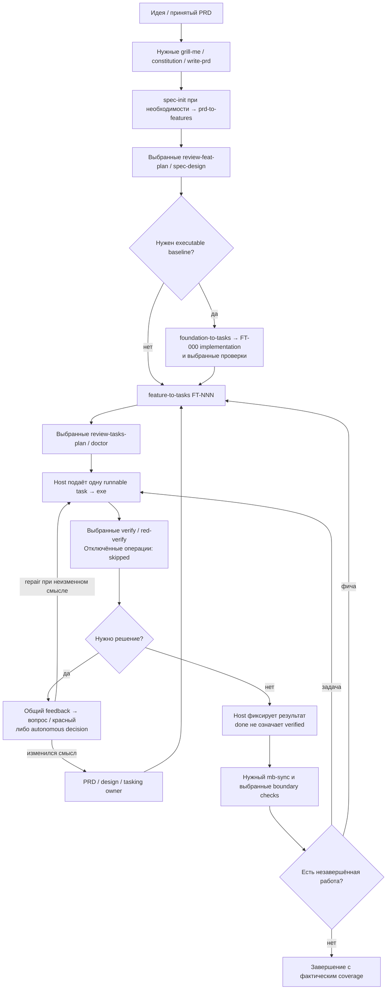

# Greenfield workflow — DevRails Nav 27

Схема показывает предметные owners и условные операции, а не алгоритм модели
или уже работающий DSH-контроллер. Ясный принятый input позволяет входить сразу
в нужную операцию; disabled design/review не требует placeholder или APPROVE.

Обычный режим ждёт согласия в основном чате или зелёного для конкретного
предложения. Отказ отменяет его; неполный ответ оставляет зависимую работу
в ожидании. То же правило действует для консультации без смены маршрута.
`/autonomous` принимает семантические решения на всём пути, но сохраняет
ручной красный/Pause/Stop, permissions и отсутствующие внешние факты.

`/autopilot` получает только подготовленную продуктовую очередь и не выполняет
FT-000. `/autonomous` охватывает также Product/Design и нужную Foundation.
У выбранной Foundation может не быть отдельной proof gate task, но реальные
baseline dependencies остаются. Judge в `/multiagentic` и `/multipilot`
условен и не принимает lifecycle решения.

Local checks `/exe`, functional verify и red-verify настраиваются отдельно.
All-off verify допускает закрытие реализации без PASS/отчёта; code-only review
сохраняет candidates; red-alone не доказывает functional acceptance.
Полученный отрицательный результат остаётся evidence и требует disposition.

После обрыва продолжение опирается на фактическую работу, partial effects и
снимок выбранных операций попытки. Выполненное не повторяется, skipped не
включается автоматически. Последовательное выполнение — baseline; concurrency
требует opt-in, изоляции и непересекающихся hard write boundaries.
Полный каталог repairs, blockers и resume: [TRANSITIONS.md](docs/nav27/TRANSITIONS.md).
