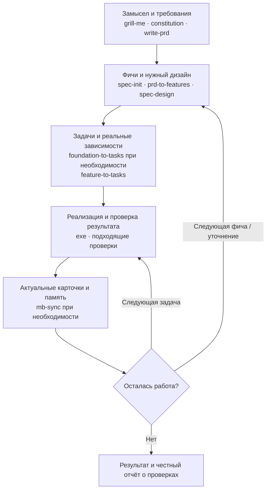

# Greenfield: ручная работа и автопилот

Основные этапы сохраняются. Команды — удобные инструменты для достижения
результата этапа; их можно сочетать, а уже готовые результаты использовать
повторно. Отдельный вызов команды, документ или новая сессия нужны по пользе.

- В manual flow агент консультируется по новым содержательным продуктовым,
  техническим и процессным решениям. Принятое решение не требует повторного
  согласования. Оператор может пропустить рекомендацию процесса обычной фразой.
- `/autonomous` проходит тот же flow самостоятельно в пределах поручения.
  `/autopilot` выполняет уже подготовленную продуктовую очередь.
- Ревью планов, `/verify`, `/red-verify`, TDD, doctor и свежие контексты —
  инструменты по необходимости, а не обязательные пропускные пункты.
- Сохраняются понятный ожидаемый результат, действительные зависимости,
  согласованные ограничения и фактические результаты проверок. Пропущенная
  проверка не считается пройденной.
- Foundation `FT-000` нужен для реально отсутствующего baseline. Продуктовые
  задачи зависят от тех результатов Foundation, которые им действительно нужны.
- При возобновлении агент читает карточку и сохранённый ход работы. Вопрос за
  пределами автономности или недоступная предпосылка останавливает зависимую
  работу; отсутствие формального approval само по себе её не останавливает.

Memory Bank и JSON-реестр остаются общими для ручного и автономного режима.
Подробности — в [howItWorks.md](howItWorks.md).
