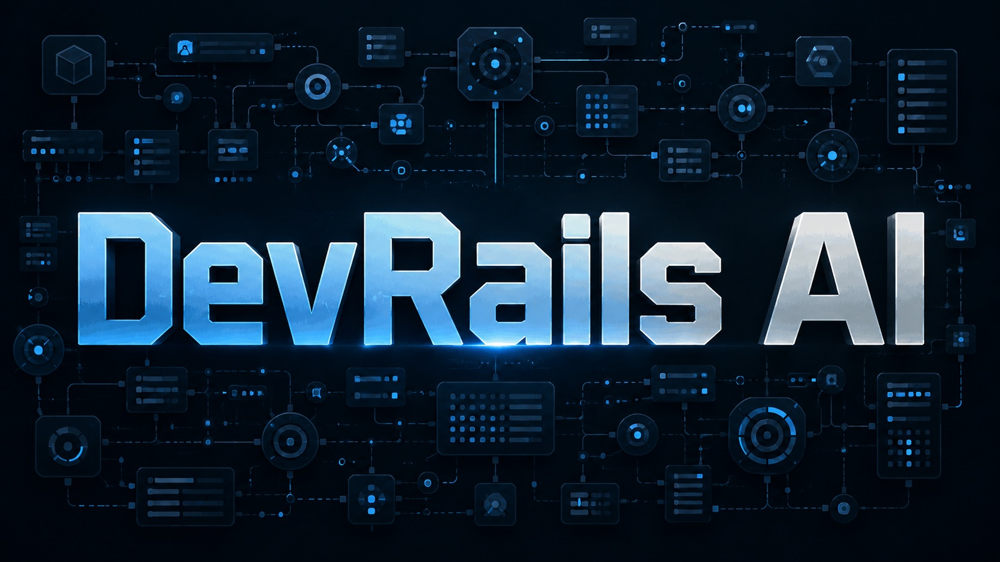

# DevRails — контролируемая фабрика агентов, поставленных на рельсы.

**Продукт:** DevRails 26 · **Версия:** 0.1.1



> `DevRails 26` работает вместе с Codex или Claude,  превращая разработку проектов в движение по рельсам лучших классических практик разработки,  удерживая текущее состояние процесса в долгосрочной памяти, чтобы  Вы могли прерваться  даже в неподходящий момент, закрыв текущую сессию и  позднее  продолжить в новом чате без существенных потерь.

Фреймворк ориентирован на джунов-вайбкодеров, которые ещё слабо разбираются во всех нюансах разработки небольших проектов до ~100 тыс. строк кода.

** Основные цели фреймворка:**

1. Формирование  фундамента проекта в виде design specs, contracts, schemas, etc, что даст  устойчивую долгосрочную пддержку.
2. Поддержка бесшовного процесса разработки с возможностью продолжения в новой сессии в большинстве случаев обрыва старой или утери текущего конткста сессии.

## **🎛️ Как пользоваться**

После развёртывания DevRails в папке проекта (находящегося на стадии идеи или частично реализованного) — разработка превращается в мягко направляемое агентами, но полностью контролируемое Вами путешевствие по всем необходимым этапам разработки от прогрева идеи до финальных e2e-тестов.


Основной flow сохраняется:

```text
Замысел и требования → фичи и дизайн → задачи → реализация и проверка → память
```

Команды помогают пройти эти этапы, но не образуют обязательную цепочку.
Агент может в рамках одной согласованной просьбы уточнить затронутые спеки,
обновить карточки, реализовать изменение, проверить его и сохранить результат.
Уже известные решения используются повторно.

В ручной работе агент консультируется с Вами по новым содержательным решениям.
Самостоятельно принимать их он может на автопилоте или по явному поручению
действовать автономно — в пределах согласованной цели и ограничений.
«Пропусти этот шаг» достаточно, чтобы отказаться от рекомендации процесса;
оформлять исключение не нужно. Реальные зависимости и честность результата
при этом сохраняются.

💾 Memory Bank остаётся костяком проекта: требования, архитектура, спецификации,
фичи, задачи и результаты позволяют продолжить работу в новой сессии. Объём
отдельных отчётов и протоколов выбирается по пользе для текущей работы.

### 🌱 Greenfield flow — проект с нуля

| Этап | Полезные команды |
|---|---|
| Прояснить замысел, принципы и требования | `/grill-me`, `/constitution`, `/write-prd` |
| Выделить фичи и нужные технические решения | `/spec-init`, `/prd-to-features`, `/spec-design` |
| Подготовить исполнимые задачи | `/foundation-to-tasks`, если нужен baseline; `/feature-to-tasks FT-001` |
| Реализовать и проверить результат | `/exe TASK-...`; `/verify` и `/red-verify`, когда полезна отдельная проверка |
| Сохранить результат и актуальное знание | обновление карточек и затронутых документов; `/mb-sync` для сверки |

Непонятный результат или реальная незавершённая зависимость требуют уточнения.
Отсутствие отдельного `APPROVE`, fresh context или полного протокола само по
себе не препятствует работе. Ревью планов и `/mb-doctor` доступны как помощь.

### 🏗️ Brownfield flow — существующий проект

Сначала агент восстанавливает фактическое состояние нужной части проекта;
`/map-codebase` помогает сохранить этот baseline в Memory Bank. Затем применяет
переданное описание изменений — delta — к тем же этапам разработки.
Код описывает текущее поведение, но сам по себе не определяет желаемый продукт.

Отдельная очередь `FT-000` полезна, когда нужно подготовить сборку, запуск или
базовую интеграцию. Если baseline уже есть, повторять его создание не требуется.

### Контракт модуля в исходнике

При создании или существенном изменении модуля с неочевидной ответственностью,
состоянием, побочными эффектами или инвариантами агент поддерживает короткий
комментарий в шапке: зачем существует модуль, чем владеет, что гарантирует и
где заканчивается его ответственность. Смысл контракта определяется до реализации;
шапка, код и затронутые спецификации поддерживаются согласованно.

Практика адаптирована из [GRACE Contract-Driven Development](https://github.com/osovv/grace-marketplace/blob/main/skills/grace/grace-explainer/references/contract-driven-dev.md).
В DevRails это локальный контекст для coding-агента: принятые требования и спеки
сохраняют приоритет, а проверки подтверждают поведение. Правило применяется по
мере работы с модулями; массовая разметка файлов, контракты простых функций и
отдельный gate наличия комментария не требуются.

## 🛠️ Уровни риска задач

Карточки сохраняют текущие уровни:

- `T0` — безопасная правка документации;
- `T1` — небольшое локальное изменение кода или теста;
- `T2` — API, данные, состояние, миграция или несколько модулей;
- `T3` — безопасность, рабочая система, платежи или риск потери данных.

Tier помогает выбрать глубину работы. Он не требует автоматически пяти файлов
протокола, TDD или нескольких независимых проходов. TDD и отдельные ревью
полезны там, где помогают проверить результат. В ручном режиме содержательный
выбор глубины обсуждается с оператором, если он ещё не согласован.
Проверки, которые не запускались, не записываются как пройденные.

## 🤖 Ручной и автоматический режимы

### 👤 Ручной режим

Поручите агенту задачу или изменение. Он консультируется по нерешённым
содержательным вопросам и исполняет согласованное без повторных разрешений.
Работу можно завершить в той же сессии с подходящей проверкой и обновлением
памяти, без отдельной процедуры назначения владельца закрытия.

### ▶️ `/autopilot`

Выполняет существующую продуктовую JSON-очередь с учётом реальных зависимостей,
сохраняет ход работы и результаты. Отдельное одобрение плана или
`/mb-doctor --strict` не является допуском к запуску. Команда не заменяет
прояснение продукта и не создаёт начальную очередь.

### ✨ `/autonomous`

**Это тестовый режим, я им еще не пользовался.**

Проводит весь flow от переданного brief, PRD или delta: готовит нужные
требования, дизайн и задачи, выполняет Foundation при необходимости и
передаёт продуктовую очередь `/autopilot`. Новые контексты и делегирование
выбираются по пользе, а не требуются для каждой фичи.

В обоих режимах агент принимает решения внутри предоставленной автономности.
Если решение выходит за её пределы, он сохраняет вопрос и точку продолжения,
приостанавливая зависимую работу. Выполнение по умолчанию последовательное;
перезапуск сначала сверяется с сохранённым состоянием, чтобы не повторять
уже выполненные действия.

### ⚖️ `/multipilot` и `/multiagentic`

Добавляют read-only Judge соответственно к `/autopilot` и `/autonomous`.
Judge помогает оценить ход работы; задачи и результаты остаются в том же flow.

## 🎭 Роли агентов

- `GENERAL` — обычный агент верхнего уровня. Запускает дополнительных агентов
  по просьбе оператора или когда это разрешено текущим поручением;
- `ORCHESTRATOR` — координирует работу и назначает отдельным агентам
исследование, реализацию, проверку или архитектурное проектирование;
- `ARCHITECT` — проектирует архитектуру и технические спецификации, сопоставляя
пользу решения со стоимостью реализации и возникающими рисками;
- `Explorer`, `Implementer` и `Reviewer` — назначаемые роли для исследования,
реализации и независимой проверки.
- `JUDGE` — read-only оценивает маршрут `/multiagentic` или `/multipilot`, не
принимая lifecycle и terminal решений за owning workflow.

`/kiss-architect` позволяет применить правила Architect к текущему
архитектурному решению без расширения полномочий агента.


## 🚀 Установка

Скачайте DevRails к себе и в папке запустите команду:

```bash
node scripts/install-framework.mjs
```

Установщик предложит выбрать проект, в который вы хотите развернуть весь мемори банк.

После установки в Codex или Claude Code и запустите `/start`, это проверит состояние проекта и запустит следующий шаг синхронизации\разработки.


## 📦 Что появится в проекте

- `.agents/skills/` и `.claude/skills/` — runtime-команды DevRails для Codex и
Claude Code;
- `.memory-bank/` — общая память проекта: архитектура, спеки, декомпозиция в задачи и код;
- `.protocols/` — записи о ходе выполнения и проверки задач;
- `.tasks/` — отчёты и подтверждения выполненной работы;
- `PAPERCUTS/` — случайно замеченные мелкие проблемы кода, архитектуры или
  структуры проекта; `PAPERCUTS/TECHDEBTS/` хранит отчёты `/tech-debt`;
- `/tech-debt` — отчёт о техническом долге;
- `AGENTS.md` — тут ключевые инструкции по работе всего Workflow. Если имеете свой AGENTS.md, позаботьтесь чтобы слить оба файла в один;
- `.memory-bank/scripts/mb-lint.mjs` и `.memory-bank/scripts/mb-doctor.mjs` — автоматические проверки
структуры и согласованности проекта; их запуск не является обязательным gate.


## 📚 Подробнее
Все существующие команды и подробное описание структуры репозитория находится
в [howItWorks.md](howItWorks.md). Схема Greenfield-пути находится в
[GREENFIELD_WORKFLOW.md](GREENFIELD_WORKFLOW.md).
